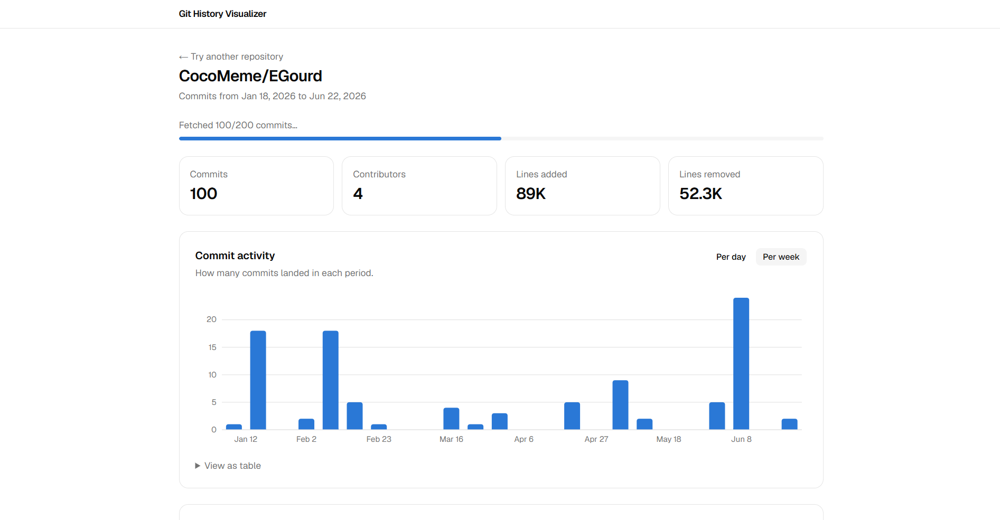
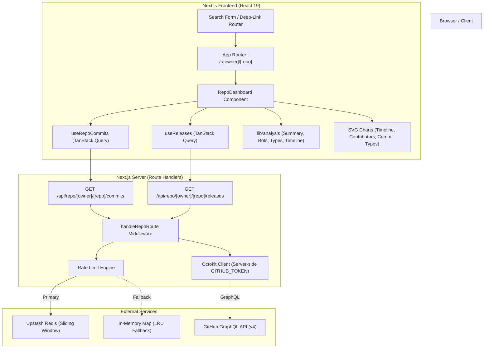

# Git History Visualizer

> A high-performance, accessible, and privacy-conscious web application for exploring commit velocity, contributor breakdown, and release milestones across any public GitHub repository.



Built with **Next.js 16 (App Router)**, **React 19**, **D3**, **Tailwind CSS v4**, and **TanStack React Query**, backed by GitHub's GraphQL API and a resilient dual-tier rate-limiting architecture.

---

## Table of Contents

- [Overview](#overview)
- [Key Features](#key-features)
- [System Architecture](#system-architecture)
  - [Architecture Diagram](#architecture-diagram)
  - [Frontend Architecture](#frontend-architecture)
  - [Backend & API Layer](#backend--api-layer)
  - [Rate Limiting & Resilience](#rate-limiting--resilience)
- [Project Structure](#project-structure)
- [API Reference](#api-reference)
  - [Endpoints](#endpoints)
  - [Envelope & Error Protocol](#envelope--error-protocol)
- [Getting Started](#getting-started)
  - [Prerequisites](#prerequisites)
  - [Installation](#installation)
  - [Environment Configuration](#environment-configuration)
  - [Running the Application](#running-the-application)
- [Testing & Quality Assurance](#testing--quality-assurance)
- [Accessibility & Usability](#accessibility--usability)
- [License](#license)

---

## Overview

**Git History Visualizer** allows developers, engineering managers, and open-source enthusiasts to inspect the trajectory of any public GitHub project without requiring personal GitHub OAuth access. By pasting a repository URL or shorthand (`owner/repo`), users receive instant visual insights into:

1. **Commit Cadence**: Trends in commit frequency over time with automatic or manual bucketing (daily/weekly).
2. **Release Overlays**: Correlating version releases directly with spikes in commit activity.
3. **Contributor Distribution**: Ranked impact across team members with lines added and removed.
4. **Conventional Commit Semantics**: Breakdown of work types (features, fixes, refactors, chores, docs, tests, etc.).
5. **Noise Reduction**: One-click filtering of automated bot accounts (e.g., Dependabot, GitHub Actions).

---

## Key Features

### 1. Interactive Commit Timeline & Release Markers
- **Dynamic Bucketing**: Automatically selects daily or weekly bucketing based on the span of commit history (switches to weekly if the span exceeds 90 days), with manual toggle controls.
- **Zero-Fill Gap Retention**: Fills quiet periods with empty buckets so periods of inactivity are truthfully depicted instead of being collapsed.
- **Release Alignment**: Up to 20 stable GitHub releases are mapped onto corresponding time buckets as interactive marker points. Pre-releases and drafts are filtered out to keep the timeline focused.
- **D3-Driven SVG Engine**: Renders crisp SVG elements scaled using `ResizeObserver` without heavy charting dependencies. Custom bar paths feature rounded caps and hover states.
- **Complete Accessibility**: Fully accessible keyboard navigation (`ArrowLeft`, `ArrowRight`, `Home`, `End`, `Escape`), ARIA live region announcements, and collapsible semantic data tables.

### 2. Contributor Impact & Velocity
- **Ranked Top Contributors**: Identifies and ranks authors by commit count, breaking ties deterministically by name.
- **Code Churn Tracking**: Displays total additions and deletions alongside commit counts.
- **Identity Resolution**: Deduplicates and tracks contributors via GitHub username (`login:user`) when available, falling back gracefully to Git author names (`name:Author`).
- **Comprehensive Data Table**: Expandable HTML table with full metrics for every author.

### 3. Conventional Commits Classification
- **Semantic Commit Analysis**: Parses commit headlines using Conventional Commits patterns (`type(scope)!: description`) and common git conventions (`Merge...`, `Revert...`, leading `Fix...`).
- **13 Granular Categories**:
  - `feat`, `fix`, `perf`, `refactor`, `docs`, `test`, `build`, `ci`, `style`, `chore`, `revert`, `merge`, and `other`.
- **Proportional Representation**: Visualized via ranked distribution bars showing count and percentage shares.

### 4. Smart Bot Filtering & URL State Persistence
- **Heuristic Detection**: Automatically detects automated accounts using standard conventions (`[bot]` suffix on author name or login, including Dependabot and Renovate).
- **Synchronized Filter**: Toggling "Hide bot commits" instantaneously updates summary statistics, timeline buckets, contributor lists, and commit type charts.
- **Shareable Deep Links**: Filter state is synced to the URL query string (`?bots=hide`) to ensure browser history navigation and shared links reproduce the exact state.

### 5. Chunked Data Ingestion & Live Progress
- **Incremental Ingestion**: Uses TanStack React Query (`useInfiniteQuery`) to stream commit pages (100 commits per page) up to the target analysis threshold (200 commits).
- **Live Progress Meter**: Real-time progress bar informs the user during background page fetching without freezing the interface.

---

## System Architecture

### Architecture Diagram



### Frontend Architecture

- **Next.js 16 App Router**: Leverages React Server Components with client-side Suspense boundaries (`DashboardSkeleton`, `EmptyRepoState`, `RepoErrorState`).
- **State & Data Fetching**: TanStack React Query v5 manages cache invalidation, background refetching, and pagination state. Caches are retained with generous stale times (5 minutes for commits, 10 minutes for releases).
- **Styling & Design Tokens**: Tailwind CSS v4 coupled with `tw-animate-css` and modern OKLCH color definitions ensure WCAG-compliant contrast ratios across light and dark themes.

### Backend & API Layer

- **Route Shell (`handleRepoRoute`)**: Every API endpoint runs through a unified wrapper providing:
  - Generation of unique tracking `requestId` (UUIDv4).
  - Strict input validation of GitHub repository references using Zod.
  - Client IP extraction and rate-limit verification prior to upstream dispatch.
  - Sanitized, leak-free error responses that shield upstream GitHub errors from end users while outputting structured JSON logs for observability.
- **GitHub GraphQL Optimization**: Queries (`COMMIT_HISTORY_QUERY`, `RELEASES_QUERY`) consume only 1 GraphQL point per 100 commits, avoiding the aggressive rate consumption of REST endpoints.
- **Secret Isolation**: `GITHUB_TOKEN` is strictly consumed server-side and never exposed to the client bundle.

### Rate Limiting & Resilience

To protect the server and token budget from abuse or exhaustion:
- **Default Limit**: 30 requests per 60-second window per client IP.
- **Client IP Resolution**: Resolves `x-forwarded-for` (safe on Vercel) or `x-real-ip`. Non-IP headers are normalized into a shared `unknown` bucket to prevent key injection attacks.
- **Tier 1 (Distributed)**: Upstash Redis sliding window limiter (`@upstash/ratelimit`).
- **Tier 2 (In-Memory Fallback)**: If Upstash is not configured or experiences network timeouts (>2s), the system automatically degrades to an in-memory sliding window limiter bounded to 10,000 keys.
- **RFC Compliance**: When throttled, the server returns HTTP `429 Too Many Requests` containing both a JSON payload and a standardized `Retry-After` header.

---

## Project Structure

```
git-visualizer/
├── app/
│   ├── api/
│   │   └── repo/[owner]/[repo]/
│   │       ├── commits/route.ts      # Paginated commit history API endpoint
│   │       └── releases/route.ts     # Release milestones API endpoint
│   ├── r/[owner]/[repo]/
│   │   └── page.tsx                  # Dynamic dashboard page with Suspense
│   ├── globals.css                   # Tailwind v4 styles and OKLCH color definitions
│   ├── layout.tsx                    # Root HTML layout with Geist font setup
│   ├── page.tsx                      # Landing page with search form and examples
│   └── providers.tsx                 # TanStack QueryClient provider wrapper
├── components/
│   ├── charts/
│   │   ├── commit-types-chart.tsx    # Conventional commit classification chart
│   │   ├── contributors-chart.tsx    # Top contributor impact chart & table
│   │   ├── ranked-bars.tsx           # Reusable accessible horizontal bar component
│   │   └── timeline-chart.tsx        # D3-scaled SVG commit activity & release chart
│   ├── ui/
│   │   └── button.tsx                # Base UI accessible button primitive
│   ├── chart-card.tsx                # Standardized card container for charts
│   ├── repo-dashboard.tsx            # Main client dashboard orchestrator
│   ├── repo-form.tsx                 # Search input with URL parsing & validation
│   ├── repo-states.tsx               # Skeleton loading, error, and empty states
│   └── stat-tile.tsx                 # Summary KPI metric display tile
├── lib/
│   ├── analysis/
│   │   ├── authors.ts                # Author aggregation and ranking algorithms
│   │   ├── bots.ts                   # Bot detection rules and filtering logic
│   │   ├── commit-types.ts           # Conventional commit regex classifier
│   │   ├── releases.ts               # Timeline placement for releases
│   │   ├── summary.ts                # Aggregate metric computations
│   │   └── timeline.ts               # Date bucketing and granularity calculators
│   ├── api/
│   │   ├── commits-client.ts         # Client-side commit fetcher
│   │   ├── commits-contract.ts       # Shared Zod schemas for commit pages
│   │   ├── describe-error.ts         # User-friendly error message resolution
│   │   ├── envelope.ts               # API response envelopes
│   │   ├── handle-repo-route.ts      # Reusable backend route wrapper
│   │   ├── releases-client.ts        # Client-side release fetcher
│   │   ├── releases-contract.ts      # Shared Zod schemas for releases
│   │   ├── request-api.ts            # Typed client fetch wrapper with abort timeout
│   │   ├── respond.ts                # JSON success/error builders
│   │   ├── use-releases.ts           # TanStack hook for release milestones
│   │   └── use-repo-commits.ts       # TanStack infinite query for commits
│   ├── charts/
│   │   ├── axis.ts                   # Axis tick distribution and alignment helpers
│   │   └── bar-path.ts               # SVG rounded bar path math generator
│   ├── format/
│   │   └── display.ts                # Number/date formatters and pluralizers
│   ├── github/
│   │   ├── classify-error.ts         # Maps Octokit errors to internal codes
│   │   ├── client.ts                 # Configured Octokit singleton instance
│   │   ├── commits.ts                # GitHub GraphQL commit queries & mapping
│   │   ├── errors.ts                 # Domain error definitions and HTTP status codes
│   │   ├── queries.ts                # Raw GraphQL query documents
│   │   ├── releases.ts               # GitHub GraphQL release queries & mapping
│   │   └── repo-ref.ts               # Repo reference validation and parsing
│   ├── rate-limit/
│   │   ├── client-ip.ts              # IP address extraction and sanitization
│   │   ├── memory-limiter.ts         # Sliding-window in-memory rate limiter
│   │   ├── request-limit.ts          # Limiter with automatic fallback strategy
│   │   └── upstash-limiter.ts        # Upstash Redis sliding window limiter
│   ├── ui/
│   │   ├── use-dashboard-filters.ts  # URL search query state synchronizer
│   │   └── use-element-width.ts      # ResizeObserver width tracking hook
│   ├── env.ts                        # Zod environment variable parsing
│   └── utils.ts                      # CSS class concatenation (`clsx` + `twMerge`)
├── tests/
│   └── api/
│       ├── commits-route.test.ts     # Commits API route test suite
│       ├── rate-limit-route.test.ts  # Route-level rate limiting tests
│       └── releases-route.test.ts    # Releases API route test suite
├── instrumentation.ts                # Server startup environment validator
├── next.config.ts                    # Next.js compiler & turbopack settings
├── package.json                      # Dependencies and scripts
└── vitest.config.mts                 # Vitest test runner configuration
```

---

## API Reference

All backend endpoints are hosted under `/api/repo/[owner]/[repo]/*`.

### Endpoints

#### 1. `GET /api/repo/[owner]/[repo]/commits`
Fetches a page of commits from the repository's default branch.

- **Query Parameters**:
  - `limit` *(optional, integer, 1–100, default: 100)*: Number of commits to retrieve per page.
  - `cursor` *(optional, string)*: Cursor string for fetching subsequent pages.
- **Example**:
  ```http
  GET /api/repo/vercel/next.js/commits?limit=100
  ```

#### 2. `GET /api/repo/[owner]/[repo]/releases`
Fetches the 100 most recent stable releases.

- **Example**:
  ```http
  GET /api/repo/facebook/react/releases
  ```

### Envelope & Error Protocol

All responses conform to a standardized JSON envelope:

#### Success Response
```json
{
  "status": "success",
  "data": { ... },
  "message": "Commits loaded"
}
```

#### Error Response
```json
{
  "status": "error",
  "data": null,
  "message": "You are making requests too quickly. Please wait a moment and try again.",
  "error": {
    "code": "TOO_MANY_REQUESTS",
    "details": [],
    "retryAfterSeconds": 45
  },
  "requestId": "9b1deb4d-3b7d-4bad-9bdd-2b0d7b3dcb6d"
}
```

#### Error Codes & Status Mappings
| Error Code | HTTP Status | Description |
| :--- | :--- | :--- |
| `INVALID_REPO` | `400` | Malformed owner or repository name |
| `INVALID_REQUEST` | `400` | Invalid query parameters (e.g. invalid cursor or limit) |
| `REPO_NOT_FOUND` | `404` | Repository does not exist or is private |
| `RATE_LIMITED` | `429` | GitHub's upstream API rate limit has been hit |
| `TOO_MANY_REQUESTS` | `429` | Client has exceeded the local request rate allowance (30 req/min) |
| `UPSTREAM_ERROR` | `502` | GitHub GraphQL API returned an unexpected error or timed out |
| `INTERNAL_ERROR` | `500` | Unhandled server exception |

---

## Getting Started

### Prerequisites

- **Node.js**: v20.x or newer recommended
- **pnpm**: v10.x or v12.x (`pnpm@12.11.2` is configured in `package.json`)
- **GitHub Personal Access Token**: A fine-grained or classic token with public repository read permissions.

### Installation

1. Clone the repository and navigate into the project directory:
   ```bash
   git clone <repository-url>
   cd git-visualizer
   ```

2. Install dependencies via `pnpm`:
   ```bash
   pnpm install
   ```

### Environment Configuration

Create a `.env.local` file by copying the provided `.env.example`:

```bash
cp .env.example .env.local
```

Populate the configuration values:

```env
# Required: GitHub Personal Access Token (Read-only, public repositories).
# Server-side only; this secret never reaches the browser.
GITHUB_TOKEN=github_pat_your_token_here

# Optional: Upstash Redis for distributed rate limiting.
# Both must be provided together, or omit both to use in-memory rate limiting.
UPSTASH_REDIS_REST_URL=https://your-upstash-instance.upstash.io
UPSTASH_REDIS_REST_TOKEN=your_upstash_rest_token
```

> **Note on Environment Validation**: The application uses Next.js `instrumentation.ts` to validate environment variables via Zod immediately on server startup. If `GITHUB_TOKEN` is missing, the application halts with a clear configuration message.

### Running the Application

- **Development Server** (with Turbopack):
  ```bash
  pnpm dev
  ```
  Visit [http://localhost:3000](http://localhost:3000) in your browser.

- **Production Build**:
  ```bash
  pnpm build
  pnpm start
  ```

---

## Testing & Quality Assurance

The codebase includes an exhaustive test suite covering analytical algorithms, rate limiters, error mapping, and API route behaviors.

```bash
# Run the entire Vitest suite once
pnpm test

# Run tests in interactive watch mode
pnpm test:watch

# Execute TypeScript typechecking
pnpm typecheck

# Run ESLint analysis
pnpm lint
```

### Coverage Highlights
- **251+ Automated Tests** across 21 test suites.
- Full verification of edge cases: empty repositories, single-commit histories, bot author detection, date bucket gap filling, invalid IP spoofing headers, Upstash Redis timeouts, and Conventional Commits headline edge cases.

---

## Accessibility & Usability

- **Keyboard First**: Every chart supports keyboard navigation. Use arrow keys (`ArrowLeft`, `ArrowRight`), `Home`, and `End` to navigate data points on the timeline.
- **Screen Reader Compatible**: Detailed `aria-label` tags and `aria-live="polite"` regions inform screen reader users of hovered values and loading state changes.
- **Tabular Alternatives**: All charts include a `<details>` disclosure widget offering a full semantic HTML table for screen readers or tabular data export.
- **High Contrast Palettes**: Colors are verified for readability on both light and dark backgrounds using custom OKLCH palette scales.

---

## License

This project is open-source. See the repository license file for terms.
